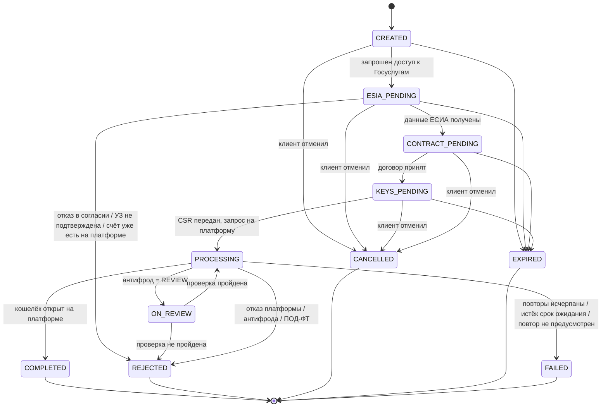
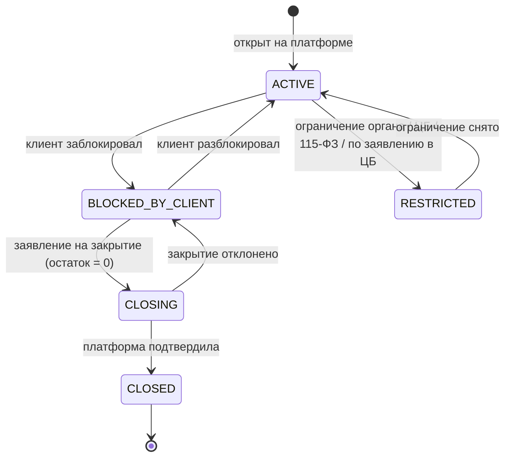
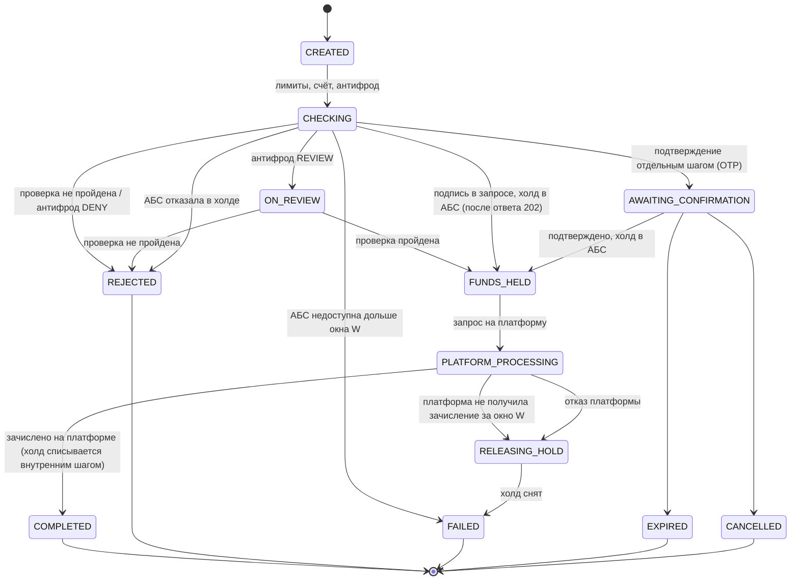

# Бизнес-правила для подготовки OAS

Работа с чувствительными данными вынесена в [[sensitive-data]], правила оформления OAS — в [[oas-conventions]], термины — в [[glossary]].

## 0. Как читать этот файл

**Идентификатор правила** — `BR-<раздел>-<номер>`. В OAS на него ссылаются из операции: `x-business-rules: [BR-DR-OPEN-01, BR-GEN-03]`.

**Тип правила** — показывает, насколько правилу можно доверять при генерации OAS:

| Тип | Значение | Как обращаться в OAS |
|---|---|---|
| **Норма** | Подтверждено законом, нормативным актом или официальными материалами Банка России. | Реализовать как обязательную проверку. Не менять без нового источника. |
| **Практика** | Типовое правило банковских систем; встречается почти везде, но конкретные значения задаёт банк. | Реализовать; конкретные значения (лимиты, таймауты) брать из задачи или помечать как параметр. |
| **Решение** | Проектное решение для КошелёкЦР (статусы, коды ошибок, последовательность). | Можно менять; при расхождении с задачей приоритет у задачи. |
| **Проверить** | Информация из вторичных источников или неполная. | Не закладывать как факт; вынести в open questions. |

**Колонка «В OAS»** — во что правило превращается: проверка → HTTP-код + бизнес-код ошибки; ограничение → `minimum`/`maximum`/`pattern`; статус → `enum`.

---

## 1. Общие правила банковских операций

### 1.1 Клиент и доступ

| ID | Правило | Тип | В OAS |
|---|---|---|---|
| BR-GEN-01 | Операцию выполняет только аутентифицированный клиент. Идентификатор клиента берётся из токена, а не из тела запроса. | Практика | `security: bearerAuth`; нет `clientId` в теле; 401 `UNAUTHORIZED`. |
| BR-GEN-02 | Клиент может работать только со своими ресурсами (счетами, кошельками, заявками). | Практика | 404 (не раскрывать существование чужого ресурса, OAS-ERR-07). |
| BR-GEN-03 | Клиент должен быть идентифицирован в банке на уровне, достаточном для операции (115-ФЗ: упрощённая / полная идентификация). | Норма | 403 `IDENTIFICATION_REQUIRED`. |
| BR-GEN-04 | Клиент не должен быть заблокирован в банке (решения ПОД/ФТ, служебная блокировка, смерть клиента). | Практика | 403 `CLIENT_BLOCKED`. |
| BR-GEN-05 | Операции сотрудника бэк-офиса выполняются под отдельной ролью и журналируются (кто, что, когда, по какому основанию). | Практика | Отдельные `tags` и `security` (scope `backoffice:*`); поле `reason` в изменяющих запросах. |

### 1.2 Банковский счёт (АБС)

| ID | Правило | Тип | В OAS |
|---|---|---|---|
| BR-ACC-01 | Счёт для списания или зачисления принадлежит клиенту, инициирующему операцию. | Практика | 403 `ACCOUNT_NOT_OWNED`. |
| BR-ACC-02 | Счёт в статусе «открыт» (не закрыт, не в процессе закрытия). | Практика | 422 `ACCOUNT_CLOSED`. |
| BR-ACC-03 | По счёту нет ограничений на расходные операции (арест, приостановление ФНС, блокировка по 115-ФЗ). | Норма | 422 `ACCOUNT_RESTRICTED`. |
| BR-ACC-04 | Валюта счёта — российский рубль (RUB). Операции с цифровым рублём возможны только с рублёвыми счетами. | Норма | 422 `ACCOUNT_CURRENCY_NOT_SUPPORTED`; в списке счетов фильтр `currency=RUB`. |
| BR-ACC-05 | Тип счёта допускает операцию (например, текущий счёт — да; вклад без права частичного снятия — нет). | Практика | 422 `ACCOUNT_TYPE_NOT_SUPPORTED`. |
| BR-ACC-06 | Доступный остаток ≥ сумма операции + комиссия. Доступный остаток = остаток − блокировки (холды). | Практика | 422 `INSUFFICIENT_FUNDS`. |
| BR-ACC-07 | На время обработки операции сумма блокируется (холд). При неуспехе блокировка снимается, при успехе — списывается. | Практика | Промежуточные статусы операции; см. §8.4. |

### 1.3 Сумма и денежные значения

| ID | Правило | Тип | В OAS |
|---|---|---|---|
| BR-AMT-01 | Сумма строго больше нуля. | Практика | `exclusiveMinimum: 0` (3.1) / `minimum` + `exclusiveMinimum: true` (3.0); 400. |
| BR-AMT-02 | Не более двух знаков после запятой (копейки). | Практика | Схема `Money` (OAS-TYPE-04). |
| BR-AMT-03 | Цифровой рубль равен безналичному рублю 1:1, курса и конвертации нет. | Норма | Одно поле `amount`, без `rate`. Валюта — `RUB`. |
| BR-AMT-04 | Сумма не превышает лимит операции, дневной или месячный лимит клиента. | Практика / Норма для ЦР | 422 `LIMIT_EXCEEDED` + в ответе `limitType`, `limitAmount`, `remainingAmount`. |

### 1.4 Подтверждение и повторы

| ID | Правило | Тип | В OAS |
|---|---|---|---|
| BR-CNF-01 | Операция, изменяющая деньги или договорные отношения, подтверждается клиентом (OTP, ЭП, биометрия, пароль кошелька). | Практика | Двухшаговая схема: `POST` создать → `POST .../confirm`; или поле `signature`. |
| BR-CNF-02 | Ограничено число попыток ввода кода (обычно 3–5) и время жизни кода (обычно 1–5 минут). Значения задаёт банк. | Практика | 422 `CONFIRMATION_CODE_INVALID` с `attemptsLeft`; 410 / 422 `CONFIRMATION_EXPIRED`; 429 `CONFIRMATION_ATTEMPTS_EXCEEDED`. |
| BR-CNF-03 | Повторная отправка кода — не чаще заданного интервала. | Практика | 429 + `Retry-After`. |
| BR-CNF-04 | Распоряжение по кошельку подписывается ключом ЭП клиента на устройстве. Подписываемые данные — канонический JSON (RFC 8785) из `walletId`, `sourceAccountId` (или счёта-получателя), `amount.value`, `amount.currency` и `Idempotency-Key`; подпись — CMS (отсоединённая) по ГОСТ Р 34.10-2012, Base64. Модуль проверяет подпись по сертификату клиента до отправки на платформу. Ключ идемпотентности в подписанных данных не даёт отправить подпись повторно с другим запросом. | Решение (25.11.2026; формат сверить с альбомом сообщений платформы) | Поле `signature`; 422 `SIGNATURE_INVALID`. |
| BR-IDM-01 | Каждая изменяющая операция идемпотентна: создание ресурса, переход статуса (принятие договора, отмена, подтверждение) и денежная операция. Повтор с тем же ключом возвращает исходный результат и не выполняет действие повторно. Без ключа клиент, получивший таймаут, не может узнать, выполнен ли переход. | Практика | Заголовок `Idempotency-Key` (UUID) обязателен для **каждого** `POST` (OAS-HDR-03). |
| BR-IDM-02 | Повтор с тем же ключом, но другим телом запроса — ошибка. | Практика | 422 `IDEMPOTENCY_KEY_REUSED`. |
| BR-IDM-03 | По ключу идемпотентности сохраняются только итоговые ответы (2xx, 4xx). Ответы 5xx не сохраняются: повтор с тем же ключом выполняет операцию заново, включая проверку антифрода. | Решение (подтверждено) | `description` параметра `IdempotencyKey`. |

### 1.5 Время и сроки

| ID | Правило | Тип | В OAS |
|---|---|---|---|
| BR-TIME-01 | Все даты фиксируются с часовым поясом; бизнес-сутки и месячные лимиты считаются по московскому времени, если задача не говорит иначе. | Практика | `format: date-time`; описание в `description` лимитов. |
| BR-TIME-02 | Незавершённая заявка или операция имеет срок жизни; по истечении переводится в `EXPIRED`. | Практика | Поле `expiresAt`; статус `EXPIRED`. |
| BR-TIME-03 | При недоступности внешней системы операция не теряется: либо возвращается явная ошибка, либо операция остаётся в промежуточном статусе и дорабатывается асинхронно. | Практика | 503/504 или 202 + статус `PROCESSING`. |

---

## 2. Антифрод и ПОД/ФТ

| ID | Правило | Тип | В OAS |
|---|---|---|---|
| BR-AF-01 | Расходные операции и открытие кошелька проходят проверку антифрода до исполнения. | Практика | В описании операции; результат влияет на статус. |
| BR-AF-02 | Результат проверки: `ALLOW` — продолжить; `DENY` — отказ; `REVIEW` — дополнительная проверка (звонок клиенту, ручной разбор). Если решение получено синхронно в запросе, который отвечает `202`, ответ `202` может сразу содержать итоговый статус `REJECTED` (или `ON_REVIEW`) — это допустимо (подтверждено 25.11.2026). | Решение | Статусы `REJECTED` / `ON_REVIEW` у операции или заявки; `202` с итоговым статусом (OAS-ASYNC-04). |
| BR-AF-03 | Причина отказа антифрода клиенту не раскрывается детально. | Практика | Общий код `OPERATION_DECLINED_BY_SECURITY`, без деталей правила. |
| BR-AF-04 | Банк проверяет получателя по базе данных Банка России о случаях и попытках переводов без добровольного согласия клиента (ФинЦЕРТ). Совпадение — основание приостановить или отклонить операцию. | Норма (161-ФЗ) | 422 `RECIPIENT_IN_FRAUD_DATABASE` или статус `SUSPENDED`. |
| BR-AF-05 | При признаках операции без согласия клиента операция **не приостанавливается**: клиенту отправляется push-уведомление с просьбой сообщить, если действие совершает не он. Если операцию потребуется отменить — каскадный откат по SAGA (компенсирующие шаги в обратном порядке). | Решение (подтверждено) | В клиентском API не отражается: push и откат — вне OAS. Отдельного статуса приостановки нет. |
| BR-AF-06 | При недоступности или таймауте антифрода модуль повторяет вызов с экспоненциальной задержкой и джиттером. Если повторы исчерпаны — операция не выполняется, клиент получает `503`; повтор клиентом снова проходит проверку антифрода (BR-IDM-03). Ни ручная проверка, ни отказ по таймауту не применяются. | Решение (подтверждено) | `503 SERVICE_UNAVAILABLE` + `Retry-After`; статус объекта не меняется. |
| BR-AML-01 | Банк выявляет операции с признаками отмывания и финансирования терроризма и может отказать в операции или в открытии кошелька. | Норма (115-ФЗ) | 422 `OPERATION_REFUSED_AML` / `WALLET_OPENING_REFUSED`. |
| BR-AML-02 | Ограничения по 115-ФЗ могут накладываться и на счёт цифрового рубля. | Норма | Статус кошелька `RESTRICTED`. |

---

## 3. Цифровой рубль: открытие счёта (кошелька)

| ID | Правило | Тип | В OAS |
|---|---|---|---|
| BR-DR-OPEN-01 | Открыть счёт цифрового рубля может совершеннолетний гражданин РФ. | Норма (cbr.ru) | Проверка по данным клиента; 422 `CLIENT_NOT_ELIGIBLE` с `reason: AGE` / `CITIZENSHIP` / `NOT_SOLE_PROPRIETOR`. Поле `reason` возвращается **всегда**, в том числе когда критерий приёмки его не упоминает (решение 25.11.2026). |
| BR-DR-OPEN-02 | У клиента должна быть подтверждённая учётная запись на Госуслугах; авторизация в ходе открытия проходит через Госуслуги (ЕСИА). | Норма | Шаг согласия на обмен данными с ЕСИА; 422 `ESIA_ACCOUNT_NOT_CONFIRMED`; 422 `ESIA_CONSENT_DENIED`. |
| BR-DR-OPEN-03 | Клиент должен обслуживаться в банке, который является участником платформы цифрового рубля. | Норма | Предусловие (наш банк — участник). |
| BR-DR-OPEN-04 | Физическое лицо может иметь не более одного счёта цифрового рубля на всей платформе, независимо от числа банков. | Норма | Проверка по данным платформы; 409 `WALLET_ALREADY_EXISTS`. |
| BR-DR-OPEN-05 | ИП может иметь до двух счетов: один как физическое лицо, второй для предпринимательской деятельности. | Норма | `ownerType: INDIVIDUAL / SOLE_PROPRIETOR`; 409 `WALLET_ALREADY_EXISTS` с указанием занятого типа. |
| BR-DR-OPEN-06 | Лица частной практики (адвокаты, нотариусы и т. п.) имеют особый порядок открытия счёта. | Решение (подтверждено) | Вне объёма продукта: третий `ownerType` не вводится. |
| BR-DR-OPEN-07 | Счёт открывается только по волеизъявлению клиента; автоматически счёт не открывается. | Норма | Обязательный явный акцепт: `accepted: true` + версия договора. |
| BR-DR-OPEN-08 | Перед открытием клиенту показываются договор счёта цифрового рубля, правила платформы и тарифы; клиент подтверждает согласие. | Норма | Операция получения договора (id, версия, документ); операция акцепта с `contractVersion`. |
| BR-DR-OPEN-09 | Договор заключается между клиентом и Банком России; банк-участник предоставляет доступ. Банк России может изменять договор в одностороннем порядке; **до принятия клиентом новой версии операции по кошельку блокируются**. | Норма / Решение (блокировка подтверждена) | Хранить версию принятого договора; операции по кошельку → 409 `CONTRACT_REACCEPTANCE_REQUIRED`. |
| BR-DR-OPEN-10 | Для доступа к счёту клиент создаёт ключи электронной подписи и сертификат ключа проверки. Закрытый ключ не покидает устройство клиента. | Норма (шаги) / Практика (хранение ключа) | В API передаётся только открытый ключ или CSR; `writeOnly`. 422 `CERTIFICATE_ISSUE_FAILED`. |
| BR-DR-OPEN-11 | Клиент задаёт пароль для доступа к счёту внутри приложения банка; пароль хранится на устройстве. | Норма (шаг) / Решение (подтверждено) | В API не передаётся. |
| BR-DR-OPEN-12 | После открытия клиенту направляется уведомление. | Норма | Событие / callback `WalletOpened`; push — вне OAS. |
| BR-DR-OPEN-13 | Открытие счёта бесплатно. | Норма | Нет поля комиссии в заявке на открытие. |
| BR-DR-OPEN-15 | Кошелёк для предпринимательской деятельности открывается только клиенту, зарегистрированному в банке как ИП; сведения об ИП банк передаёт в Банк России при открытии счёта. | Норма (передача сведений) / Практика (проверка в АБС) | 422 `CLIENT_NOT_ELIGIBLE` с `reason: NOT_SOLE_PROPRIETOR`. |
| BR-DR-OPEN-14 | Банк проводит идентификацию клиента при открытии счёта и может отказать в открытии по основаниям ПОД/ФТ. | Норма | 422 `WALLET_OPENING_REFUSED`. |

---

## 4. Цифровой рубль: пополнение и вывод

| ID | Правило | Тип | В OAS |
|---|---|---|---|
| BR-DR-TOP-01 | Пополнение — перевод безналичных рублей со своего банковского счёта на свой счёт цифрового рубля (по распоряжению клиента банку-участнику). | Норма | `POST /wallets/{walletId}/top-ups`; источник — `sourceAccountId` клиента. |
| BR-DR-TOP-02 | Для физлица пополнение со счетов в банках (и из электронных денег) ограничено 300 000 ₽ в месяц суммарно. Для бизнеса лимита нет. | Норма | 422 `TOP_UP_MONTHLY_LIMIT_EXCEEDED` + `remainingAmount`; операция получения остатка лимита. |
| BR-DR-TOP-03 | Месячный лимит пополнения — общий на платформе, а не на банк; остаток лимита учитывает и возвращает платформа. | Решение (подтверждено для КошелёкЦР) | Остаток лимита запрашивается у платформы, локально не считается. |
| BR-DR-TOP-04 | Лимит пополнения считается за **скользящие 30 дней** (сумма успешных пополнений за последние 30 дней до момента операции). | Решение (подтверждено) | `description` лимита; поле периода — `windowDays: 30`. |
| BR-DR-TOP-05 | Пополнение и вывод для граждан бесплатны. | Норма | `fee = 0`; поле `fee` оставить для расширения. |
| BR-DR-TOP-06 | Пополнение исполняется как связка: холд на счёте в АБС → зачисление на платформе → списание холда. При отказе платформы холд снимается. Холд ставится после ответа `202` (асинхронно); операция считается завершённой (`COMPLETED`) после зачисления на платформе, списание холда — внутренний шаг банка (решение 25.11.2026). | Решение (типовая сага) | Статусы операции; ответ 202 + опрос или callback. |
| BR-DR-TOP-07 | Если платформа отказала в зачислении по причине, которую клиент не может исправить (или по основаниям ПОД/ФТ), клиент получает общий код; причина платформы пишется только во внутренний журнал. | Решение (25.11.2026) | `errorCode: WALLET_CREDIT_REFUSED` у операции в `FAILED` (SD-API-15). |
| BR-DR-WDR-01 | Вывод (обратный перевод) — со своего счёта цифрового рубля на свой банковский счёт. | Норма | `POST /wallets/{walletId}/withdrawals`; `targetAccountId` клиента. |
| BR-DR-WDR-02 | Лимита на вывод для граждан нет; сумма ограничена остатком кошелька. | Норма | 422 `INSUFFICIENT_WALLET_BALANCE`. |
| BR-DR-WDR-03 | Вывод исполняется как: списание на платформе → зачисление на счёт в АБС. При сбое зачисления — возврат на кошелёк (компенсация) или доработка с повтором. | Решение | Статусы `COMPENSATING`, `REFUNDED`. |
| BR-DR-OPS-01 | Переводы между счётом цифрового рубля и банковским счётом мгновенные (с точки зрения клиента). | Норма | НФТ времени ответа; допускается 202 при задержке платформы. |
| BR-DR-OPS-02 | На остаток не начисляются проценты; кредиты в цифровых рублях не выдаются. | Норма | Нет полей процентов и кредитного лимита. |
| BR-DR-OPS-03 | Банк не распоряжается средствами в цифровых рублях, а только даёт доступ; остаток учитывается на платформе. | Норма | Баланс кошелька — данные платформы (не кэш АБС); поле `balanceAsOf`. |

---

## 5. Цифровой рубль: переводы другому человеку

| ID | Правило | Тип | В OAS |
|---|---|---|---|
| BR-DR-TRF-01 | Перевод возможен по номеру телефона или номеру счёта цифрового рубля. | Норма | `recipient: oneOf [{ phone }, { walletNumber }]`. |
| BR-DR-TRF-02 | У получателя обязательно должен быть открыт счёт цифрового рубля. | Норма | 422 `RECIPIENT_WALLET_NOT_FOUND`. |
| BR-DR-TRF-03 | Перед переводом клиенту показываются данные получателя для сверки (обычно имя и инициал фамилии). | Практика | Операция поиска получателя; маскирование — по [[sensitive-data]]. |
| BR-DR-TRF-04 | Лимитов на переводы внутри платформы нет; сумма ограничена остатком. | Норма | 422 `INSUFFICIENT_WALLET_BALANCE`. |
| BR-DR-TRF-05 | Переводы для граждан бесплатны. | Норма | `fee = 0`. |
| BR-DR-TRF-06 | Нельзя перевести самому себе на тот же кошелёк. | Практика | 422 `SAME_WALLET_TRANSFER`. |
| BR-DR-TRF-07 | Перевод проходит проверку антифрода и базы ФинЦЕРТ (см. [[#2. Антифрод и ПОД/ФТ]]). | Норма | См. BR-AF-*. |

---

## 6. Цифровой рубль: ограничения, блокировка, закрытие

| ID | Правило | Тип | В OAS |
|---|---|---|---|
| BR-DR-RST-01 | Клиент может временно заблокировать счёт в приложении и разблокировать его. | Норма | `POST /wallets/{id}/block`, `/unblock`; статус `BLOCKED_BY_CLIENT`. |
| BR-DR-RST-02 | Через контактный центр Банка России клиент может установить ограничение: приостановить все операции, запретить расходные или запретить приходные операции. | Норма | Поле `restrictions: [DEBIT_PROHIBITED, CREDIT_PROHIBITED, ALL_SUSPENDED]` (только чтение для банка). |
| BR-DR-RST-03 | Операции могут быть приостановлены по документам уполномоченных органов — на весь остаток или на указанную сумму. | Норма | `restrictions[].amount`; доступный остаток учитывает блокировку; 422 `WALLET_RESTRICTED`. |
| BR-DR-RST-04 | При банкротстве гражданина зачисления на счёт без ограничений, расходные операции — только с согласия финансового управляющего на каждую операцию. | Норма | Ограничение `DEBIT_REQUIRES_MANAGER_CONSENT`; 422 `WALLET_RESTRICTED`. |
| BR-DR-RST-05 | Ограничения по 115-ФЗ применяются и к счёту цифрового рубля. | Норма | См. BR-AML-02. |
| BR-DR-CLS-01 | Закрыть счёт можно только при нулевом остатке; остаток предварительно переводится на свой банковский счёт или другому человеку. | Норма | 422 `WALLET_BALANCE_NOT_ZERO`. |
| BR-DR-CLS-02 | Перед закрытием счёт блокируется; затем закрывается. Закрытие означает расторжение договора. | Норма | Переход `ACTIVE → BLOCKED → CLOSING → CLOSED`. |
| BR-DR-CLS-03 | Чтобы снова пользоваться цифровым рублём, счёт открывается заново. | Норма | Из `CLOSED` нет переходов; новая заявка → новый кошелёк. |

---

## 7. Тарифы платформы

| ID | Правило | Тип | В OAS |
|---|---|---|---|
| BR-DR-FEE-01 | Для граждан все операции с цифровыми рублями бесплатны (C2C, пополнение, вывод, оплата). | Норма | `fee.amount = 0`. |
| BR-DR-FEE-02 | Для бизнеса до 31.12.2026 действует льготный период (нулевые тарифы). С 01.01.2027: приём оплаты от граждан (C2B) — 0,3 %, не более 1 500 ₽; ЖКУ — 0,2 %; переводы между компаниями — 15 ₽. Тарифы платит получатель. | Норма (решение СД Банка России от 28.08.2026) | Вне текущих фич; при появлении C2B — поле `fee` и `feePayer`. |
| BR-DR-FEE-03 | Тарифы устанавливает Банк России как оператор платформы и может их менять. | Норма | Тарифы не зашивать в схему; получать из справочника. |

---

## 8. Статусные модели

Модели ниже — **проектные решения** (тип «Решение»), согласованные с нормами из разделов 3–6. Диаграммы в Mermaid отображаются в Obsidian.

### 8.1 Заявка на открытие кошелька (`WalletApplication`)

| Статус | Смысл | Финальный | Причина в ответе |
|---|---|---|---|
| `CREATED` | Заявка создана, проверки предусловий пройдены. | Нет | — |
| `ESIA_PENDING` | Ожидается согласие и данные из Госуслуг. | Нет | — |
| `CONTRACT_PENDING` | Договор показан, ожидается акцепт. | Нет | — |
| `KEYS_PENDING` | Ожидается открытый ключ / CSR. | Нет | — |
| `PROCESSING` | Идёт регистрация на платформе и проверки. | Нет | — |
| `ON_REVIEW` | Дополнительная проверка (антифрод, ПОД/ФТ). | Нет | — |
| `COMPLETED` | Кошелёк открыт; в заявке есть `walletId`. | Да | — |
| `REJECTED` | Отказ по бизнес-причине. | Да | `rejectReason` (enum) |
| `CANCELLED` | Клиент отменил (возможно до передачи запроса на сертификат). | Да | — |
| `EXPIRED` | Истёк срок жизни заявки. | Да | — |
| `FAILED` | Техническая ошибка без возможности повтора: повторы исчерпаны, истёк срок ожидания результата или повтор для шага не предусмотрен (в т. ч. недоступно уточнение статуса INT-DRP-08). | Да | `errorCode` — **обязателен**: `PLATFORM_UNAVAILABLE` (система недоступна, повторы исчерпаны или не предусмотрены), `UPSTREAM_TIMEOUT` (истёк срок ожидания результата) |

Правила переходов:
- Новая заявка запрещена, пока есть активная (нефинальная) заявка того же клиента и того же `ownerType` → 409 `APPLICATION_IN_PROGRESS` (вернуть id активной).
- Шаги выполняются строго по порядку; вызов шага не в своём статусе → 409 `INVALID_APPLICATION_STATE`.

### 8.2 Кошелёк (`Wallet`, счёт цифрового рубля)

| Статус | Пополнение | Вывод / перевод | Входящие переводы |
|---|---|---|---|
| `ACTIVE` | Да | Да | Да |
| `BLOCKED_BY_CLIENT` | Нет | Нет | Нет |
| `RESTRICTED` | По типу ограничения | По типу ограничения | По типу ограничения |
| `CLOSING` | Нет | Нет | Нет |
| `CLOSED` | Нет | Нет | Нет |

`RESTRICTED` уточняется списком `restrictions[]` (BR-DR-RST-02…05): тип, сумма, основание, дата.

Клиентский API (решение 25.11.2026): закрытый кошелёк (`CLOSED`) считается несуществующим — в списках не возвращается, операции по нему отвечают 404 (OAS-ERR-07). Операция пополнения кошелька в `CLOSING` отклоняется кодом `WALLET_BLOCKED`: в `CLOSING` кошелёк попадает только из `BLOCKED_BY_CLIENT`.

### 8.3 Согласие (`Consent`)

| Статус | Смысл | Переходы |
|---|---|---|
| `REQUESTED` | Запрошено у клиента. | → `GRANTED`, `DENIED`, `EXPIRED` |
| `GRANTED` | Дано; хранится версия документа и время. | → `REVOKED`, `SUPERSEDED` |
| `DENIED` | Клиент отказал. | финальный |
| `REVOKED` | Отозвано клиентом. | финальный |
| `SUPERSEDED` | Заменено новой версией (например, после изменения договора Банком России). | финальный |
| `EXPIRED` | Истёк срок ожидания или действия. | финальный |

Типы согласий (`consentType`): `ESIA_DATA_SHARING`, `DR_ACCOUNT_CONTRACT`, `PLATFORM_RULES_AND_TARIFFS`, `PERSONAL_DATA_PROCESSING`.

### 8.4 Операция пополнения (`TopUp`)

Правила:
- `AWAITING_CONFIRMATION` используется, только если продукт требует подтверждения отдельным шагом; если подпись клиента передаётся в запросе создания, операция переходит из `CHECKING` сразу в `FUNDS_HELD`.
- Отмена клиентом возможна только до `FUNDS_HELD`.
- При неопределённом ответе платформы (таймаут) операция остаётся в `PLATFORM_PROCESSING` и уточняется запросом статуса на платформе; повторная отправка без проверки статуса запрещена (риск двойного зачисления).
- Остаток месячного лимита уменьшается в `COMPLETED`; на время обработки сумма резервируется в лимите.
- Решение 25.11.2026: при подписи в запросе ответ `202` возвращается после антифрода, операция в `CHECKING`; холд ставится асинхронно. `COMPLETED` наступает после зачисления на платформе; списание холда (INT-ABS-04) клиенту не видно. `RELEASING_HOLD` сохраняется, пока холд не снят.
- Атрибуты: `REJECTED` — `rejectReason` (`OPERATION_DECLINED_BY_SECURITY`, `INSUFFICIENT_FUNDS`, `ACCOUNT_RESTRICTED`, `ACCOUNT_CLOSED`); `FAILED` — `errorCode` (`TOP_UP_MONTHLY_LIMIT_EXCEEDED`, `WALLET_RESTRICTED`, `WALLET_CREDIT_REFUSED`, `PLATFORM_UNAVAILABLE`, `CORE_BANKING_UNAVAILABLE`).

### 8.5 Операция вывода (`Withdrawal`)

`CREATED → CHECKING → AWAITING_CONFIRMATION → PLATFORM_DEBITING → CREDITING_ACCOUNT → COMPLETED`

Ветки ошибок: `CHECKING → REJECTED`; `CHECKING → ON_REVIEW → PLATFORM_DEBITING | REJECTED` (антифрод `REVIEW`); `AWAITING_CONFIRMATION` — только при подтверждении отдельным шагом; `PLATFORM_DEBITING → FAILED` (списание не прошло); `CREDITING_ACCOUNT → COMPENSATING → REFUNDED` (зачисление в АБС не удалось, средства возвращены на кошелёк).

### 8.6 Перевод (`Transfer`)

`CREATED → RECIPIENT_RESOLVED → CHECKING → AWAITING_CONFIRMATION → PROCESSING → COMPLETED`

Ветки: `RECIPIENT_RESOLVED` недостижим, если у получателя нет кошелька (→ `REJECTED`, `RECIPIENT_WALLET_NOT_FOUND`); `CHECKING → SUSPENDED` (антифрод / ФинЦЕРТ) → `PROCESSING` или `REJECTED`; `PROCESSING → FAILED`.

### 8.7 Сертификат ключа проверки ЭП (`Certificate`)

| Статус | Смысл |
|---|---|
| `REQUESTED` | CSR передан. |
| `ISSUED` | Сертификат выпущен, действует. |
| `REJECTED` | Выпуск отклонён. |
| `EXPIRED` | Истёк срок действия; нужен перевыпуск. |
| `REVOKED` | Отозван (смена устройства, компрометация). |

Правило: операции по кошельку требуют действующего сертификата (`ISSUED`); иначе 403 `CERTIFICATE_INVALID`.

### 8.8 Проверка антифрода (`FraudCheck`)

`ALLOW` / `DENY` / `REVIEW` → для `REVIEW`: `PENDING → APPROVED | DECLINED`. Внутренняя сущность; клиенту не раскрывается (BR-AF-03), сотруднику бэк-офиса — видна.

---

## 9. Сводный каталог бизнес-кодов ошибок

Коды передаются в поле `code` схемы `Problem` (формат — [[oas-conventions#8. Ответы и ошибки]]).

| Код | HTTP | Правило |
|---|---|---|
| `UNAUTHORIZED` | 401 | BR-GEN-01 |
| `RESOURCE_NOT_FOUND` | 404 | BR-GEN-02 |
| `FORBIDDEN` | 403 | BR-GEN-05 (нет прав роли) |
| `IDENTIFICATION_REQUIRED` | 403 | BR-GEN-03 |
| `CLIENT_BLOCKED` | 403 | BR-GEN-04 |
| `CERTIFICATE_INVALID` | 403 | 8.7 |
| `SIGNATURE_INVALID` | 422 | BR-CNF-04 |
| `CLIENT_NOT_ELIGIBLE` | 422 | BR-DR-OPEN-01, BR-DR-OPEN-15 |
| `ESIA_ACCOUNT_NOT_CONFIRMED` | 422 | BR-DR-OPEN-02 |
| `ESIA_CONSENT_DENIED` | 422 | BR-DR-OPEN-02 |
| `WALLET_ALREADY_EXISTS` | 409 | BR-DR-OPEN-04, 05 |
| `APPLICATION_IN_PROGRESS` | 409 | 8.1 |
| `INVALID_APPLICATION_STATE` | 409 | 8.1 |
| `CONTRACT_VERSION_OUTDATED` | 409 | BR-DR-OPEN-09 |
| `CONTRACT_REACCEPTANCE_REQUIRED` | 409 | BR-DR-OPEN-09 |
| `CERTIFICATE_ISSUE_FAILED` | 422 | BR-DR-OPEN-10 |
| `WALLET_OPENING_REFUSED` | 422 | BR-DR-OPEN-14, BR-AML-01 |
| `ACCOUNT_NOT_OWNED` | 403 | BR-ACC-01 |
| `ACCOUNT_CLOSED` | 422 | BR-ACC-02 |
| `ACCOUNT_RESTRICTED` | 422 | BR-ACC-03 |
| `ACCOUNT_CURRENCY_NOT_SUPPORTED` | 422 | BR-ACC-04 |
| `ACCOUNT_TYPE_NOT_SUPPORTED` | 422 | BR-ACC-05 |
| `INSUFFICIENT_FUNDS` | 422 | BR-ACC-06 |
| `INSUFFICIENT_WALLET_BALANCE` | 422 | BR-DR-WDR-02, BR-DR-TRF-04 |
| `LIMIT_EXCEEDED` | 422 | BR-AMT-04 |
| `TOP_UP_MONTHLY_LIMIT_EXCEEDED` | 422 | BR-DR-TOP-02 |
| `WALLET_RESTRICTED` | 422 | BR-DR-RST-03, 04 |
| `WALLET_BLOCKED` | 422 | 8.2 |
| `WALLET_BALANCE_NOT_ZERO` | 422 | BR-DR-CLS-01 |
| `WALLET_CREDIT_REFUSED` | — (`errorCode` операции) | BR-DR-TOP-07 |
| `RECIPIENT_WALLET_NOT_FOUND` | 422 | BR-DR-TRF-02 |
| `SAME_WALLET_TRANSFER` | 422 | BR-DR-TRF-06 |
| `RECIPIENT_IN_FRAUD_DATABASE` | 422 | BR-AF-04 |
| `OPERATION_DECLINED_BY_SECURITY` | 422 | BR-AF-03 |
| `OPERATION_REFUSED_AML` | 422 | BR-AML-01 |
| `CONFIRMATION_CODE_INVALID` | 422 | BR-CNF-02 |
| `CONFIRMATION_EXPIRED` | 422 | BR-CNF-02 |
| `CONFIRMATION_ATTEMPTS_EXCEEDED` | 429 | BR-CNF-02 |
| `IDEMPOTENCY_KEY_REUSED` | 422 | BR-IDM-02 |
| `VALIDATION_ERROR` | 400 | BR-AMT-01, 02 и форматные проверки |
| `TOO_MANY_REQUESTS` | 429 | NFR лимитов частоты продукта |
| `INTERNAL_ERROR` | 500 | — |
| `PLATFORM_UNAVAILABLE` | 503 | BR-TIME-03 |
| `ESIA_UNAVAILABLE` | 503 | BR-TIME-03 |
| `SERVICE_UNAVAILABLE` | 503 | BR-AF-06 (антифрод; система клиенту не называется) |
| `CORE_BANKING_UNAVAILABLE` | 503 | BR-TIME-03 |
| `UPSTREAM_TIMEOUT` | 504 | BR-TIME-03 |

---

## 10. Открытые вопросы (не закладывать в OAS как факт)

Открытых вопросов нет. Решения от 23.11.2026:

| Вопрос | Решение | Правило |
|---|---|---|
| Третий тип кошелька для лиц частной практики | Не нужен | BR-DR-OPEN-06 |
| Пароль к счёту | Локальный, в API не передаётся | BR-DR-OPEN-11 |
| Период лимита пополнения | Скользящие 30 дней | BR-DR-TOP-04 |
| Подозрение на операцию без согласия | Без приостановки: push клиенту, при необходимости — откат по SAGA | BR-AF-05 |
| Недоступность антифрода | Повтор с экспоненциальной задержкой и джиттером, затем `503` | BR-AF-06 |
| Входящие зачисления при `BLOCKED_BY_CLIENT` | Запрещены | §8.2 |
| Одностороннее изменение договора | Операции блокируются до повторного принятия | BR-DR-OPEN-09 |

Решения от 25.11.2026 (пополнение, SCRUM-2195):

| Вопрос | Решение | Правило |
|---|---|---|
| Подписываемое распоряжение | Канонический JSON с `Idempotency-Key`, CMS по ГОСТ, проверка подписи модулем | BR-CNF-04 |
| Таймаут блокировки в АБС | Блокировка идемпотентна по id операции и выполняется после ответа 202 | BR-DR-TOP-06, integrations «АБС» |
| Повторная отправка зачисления | Серии `RP-EXP` в окне 10 мин; платформа отбрасывает дубли по id | integrations «Платформа ЦР» |
| Кошелёк в `CLOSING` / `CLOSED` | `CLOSING` → `WALLET_BLOCKED`; `CLOSED` → 404 | §8.2 |
| Сбой списания / снятия блокировки | Повтор по id блокировки; `COMPLETED` после зачисления; `RELEASING_HOLD` до снятия | §8.4, integrations «АБС» |
| Счета с ограничениями на расход | Показываются с признаком `debitAllowed: false`, без основания | FR-TOP-01, SD-API-15 |
| Отказ платформы вне таблицы соответствия | Общий код `WALLET_CREDIT_REFUSED` | BR-DR-TOP-07 |
| Время ответа создания пополнения | Чтения параллельно, 202 после антифрода, таймаут клиента 10 с | NFR-PERF-06 |

---

## Источники

- Банк России. Цифровой рубль (раздел для граждан): https://cbr.ru/PSystem/dr/home/
- Банк России. Как открыть и пополнить счёт цифрового рубля: https://cbr.ru/PSystem/dr/open_dr_account/
- Банк России. Как управлять счётом цифрового рубля: https://cbr.ru/PSystem/dr/manage_dr_account/
- Банк России. В каких случаях операции по счёту цифрового рубля могут быть ограничены: https://cbr.ru/PSystem/dr/transactions_dr/
- Банк России. Цифровой рубль: старт использования (31.08.2026): https://cbr.ru/press/event?id=32802
- Банк России. Решение СД о тарифах с 01.09.2026: https://www.cbr.ru/rbr/dir_decisions/rsd_2026-08-28_45_01/
- Банк России. Тарифы платформы: https://cbr.ru/PSystem/dr/doc_dr/tarif/dr_t-1/
- Федеральный закон от 23.07.2025 № 248-ФЗ (сроки массового внедрения); 161-ФЗ «О национальной платёжной системе»; 115-ФЗ «О противодействии легализации…».
