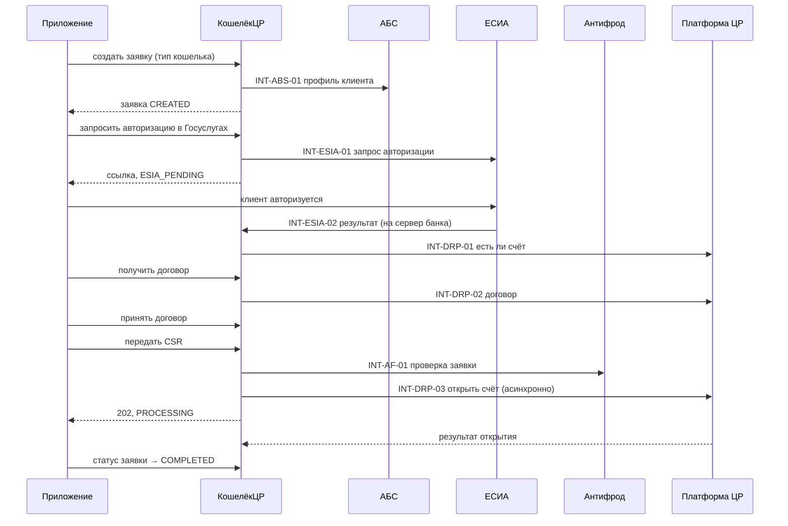
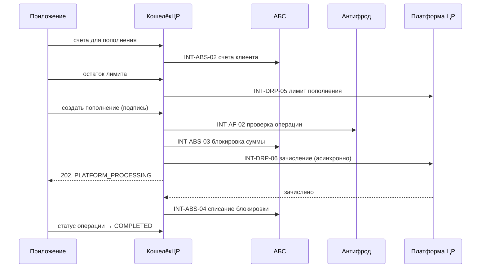

# КошелёкЦР — внешние интеграции и контракты

> [!warning] Учебная модель контрактов
> Контракты ниже — **упрощённая модель** для учебного проекта. Они описывают, какие данные модуль получает и передаёт, но **не воспроизводят** реальные API платформы цифрового рубля, ЕСИА или конкретной АБС. Реальные форматы определяются документацией Банка России (альбом электронных сообщений платформы), регламентом ЕСИА и документацией АБС банка.

Идентификаторы операций: `INT-<система>-<номер>`. Коды систем используются в `x-external-systems` (OAS-OP-04).

| Система | Код | Раздел |
|---|---|---|
| АБС банка | `CORE_BANKING` | [[#АБС]] |
| Госуслуги (ЕСИА) | `ESIA` | [[#ЕСИА]] |
| Платформа цифрового рубля Банка России | `DR_PLATFORM` | [[#Платформа ЦР]] |
| Антифрод банка | `ANTIFRAUD` | [[#Антифрод]] |

**Что из этого файла попадает в клиентскую OAS.** Внешние вызовы в клиентском API не описываются как операции. Они определяют: `x-external-systems` операции, синхронный или асинхронный ответ, ответы `502` / `503` / `504` и бизнес-коды ошибок по таблицам соответствия ниже.

---

## Схемы взаимодействия

### Открытие кошелька

### Пополнение кошелька

---

## Политика повтора

Единая политика `RP-EXP` для вызовов внешних систем (NFR-AV-05). Подтверждена 23.11.2026; конкретные числа — значения по умолчанию для примера.

| Параметр | Значение |
|---|---|
| Алгоритм | Экспоненциальная задержка с полным джиттером: задержка перед повтором *n* — случайное значение от 0 до `min(cap, base × 2^n)` |
| `base` / `cap` | 200 мс / 2 с |
| Попыток всего | 3 (первая + 2 повтора) |
| Что повторяется | Таймаут, недоступность (сетевые ошибки, 502/503/504 системы). Бизнес-отказы (4xx системы) не повторяются |
| Где **не** применяется | Изменяющие операции АБС (INT-ABS-03…06) и асинхронная отправка на платформу (INT-DRP-03, 06) — повтор только после уточнения статуса (INT-DRP-08, NFR-AV-03) |

| Система | Таймаут попытки | Повтор | После исчерпания повторов |
|---|---|---|---|
| АБС — чтение (INT-ABS-01, 02) | 1 с | `RP-EXP` | `503 CORE_BANKING_UNAVAILABLE` / `504 UPSTREAM_TIMEOUT` |
| ЕСИА (INT-ESIA-01, 02) | 20 с | `RP-EXP` | INT-ESIA-01 — `503 ESIA_UNAVAILABLE`; INT-ESIA-02 — см. [[#ЕСИА]] |
| Платформа ЦР — синхронные (INT-DRP-01, 02, 04, 05, 08) | 1,5 с | `RP-EXP` | `503 PLATFORM_UNAVAILABLE` / `504 UPSTREAM_TIMEOUT`; для INT-DRP-01 — см. [[#Платформа ЦР]] |
| Платформа ЦР — асинхронные (INT-DRP-03, 06) | 1,5 с на приём | Только после INT-DRP-08 | См. [[#Платформа ЦР]] |
| Антифрод (INT-AF-01, 02) | 500 мс | `RP-EXP` | `503 SERVICE_UNAVAILABLE`, объект не меняется; повтор клиентом — новая проверка (BR-AF-06, BR-IDM-03) |

> [!warning] Время ответа при повторах
> Для ЕСИА худший случай — 3 попытки по 20 с. Это не противоречит NFR-PERF-01 (p95 ≤ 2 с), но таймаут API Gateway для операции `INT-ESIA-01` должен быть больше худшего случая — открытый вопрос к архитектору.

---

## АБС

**Назначение:** источник данных клиента и счетов; блокировка, списание и зачисление средств на банковских счетах.
**Протокол:** внутренний REST-адаптер банка (детали — документация АБС). **Режим:** синхронно.
**Таймаут:** 1 с. **Повтор:** операции чтения — `RP-EXP`; изменяющие операции — без повтора ([[#Политика повтора]]).

| ID | Операция | Вход | Выход | Где используется |
|---|---|---|---|---|
| INT-ABS-01 | Профиль клиента | id клиента | дата рождения, гражданство, уровень идентификации, признак блокировки, признак ИП и сведения об ИП (ОГРНИП, ИНН, наименование) | Открытие: шаг 2; FR-OPEN-02, FR-OPEN-09 |
| INT-ABS-02 | Счета клиента | id клиента, тип владельца (физлицо / ИП) | список счетов: id, номер, валюта, тип, статус, доступный остаток, ограничения | FR-TOP-01 |
| INT-ABS-03 | Блокировка суммы | id счёта, сумма, id операции | id блокировки | FR-TOP-06 |
| INT-ABS-04 | Списание блокировки | id блокировки | результат | FR-TOP-06 |
| INT-ABS-05 | Снятие блокировки | id блокировки | результат | FR-TOP-06 (отказ платформы) |
| INT-ABS-06 | Зачисление на счёт | id счёта, сумма, id операции | результат | Вывод — вне объёма |

Соответствие ошибок:

| Ошибка АБС | Код модуля | HTTP |
|---|---|---|
| Клиент не найден / заблокирован | `CLIENT_BLOCKED` | 403 |
| Недостаточный уровень идентификации | `IDENTIFICATION_REQUIRED` | 403 |
| Счёт не принадлежит клиенту | `ACCOUNT_NOT_OWNED` | 403 |
| Счёт закрыт | `ACCOUNT_CLOSED` | 422 |
| Ограничения по счёту | `ACCOUNT_RESTRICTED` | 422 |
| Недостаточно средств | `INSUFFICIENT_FUNDS` | 422 |
| Недоступна / таймаут | `CORE_BANKING_UNAVAILABLE` / `UPSTREAM_TIMEOUT` | 503 / 504 |

---

## ЕСИА

**Назначение:** подтверждение личности клиента и получение подтверждённых данных для открытия счёта цифрового рубля.
**Протокол:** OAuth 2.0 / OpenID Connect по регламенту ЕСИА. **Режим:** асинхронно — клиент уходит на Госуслуги, результат приходит на сервер банка.
**Таймаут:** 20 с. **Повтор:** `RP-EXP` ([[#Политика повтора]]).

| ID | Операция | Вход | Выход | Где используется |
|---|---|---|---|---|
| INT-ESIA-01 | Запрос авторизации | id заявки (как `state`), запрашиваемые данные | URL для перехода клиента на Госуслуги | Открытие: шаг 3; FR-OPEN-03 |
| INT-ESIA-02 | Результат авторизации | код авторизации (на сервер банка) | признак подтверждённой учётной записи, ФИО, дата рождения, СНИЛС, данные паспорта | Открытие: шаг 4 |

Правила:
- Обработка результата (INT-ESIA-02) — служебный endpoint сервера банка, **не часть клиентского API** (SCRUM-2194, «Не входит»).
- Код авторизации и токены ЕСИА — данные уровня C3: клиенту не возвращаются ([[sensitive-data]], §3.3).
- Полученные из ЕСИА ПДн клиенту не возвращаются; клиент видит только статус заявки (SD-API-16).

Соответствие ошибок (влияют на статус заявки, а не на HTTP-ответ клиенту):

| Результат ЕСИА | Статус заявки | Причина |
|---|---|---|
| Клиент отказал в доступе | `REJECTED` | `ESIA_CONSENT_DENIED` |
| Учётная запись не подтверждена | `REJECTED` | `ESIA_ACCOUNT_NOT_CONFIRMED` |
| ЕСИА недоступна при запросе авторизации (INT-ESIA-01), повторы исчерпаны | без изменений | HTTP 503 `ESIA_UNAVAILABLE` / 504 `UPSTREAM_TIMEOUT` |
| ЕСИА недоступна при обмене кода на данные (INT-ESIA-02), повторы исчерпаны | без изменений (`ESIA_PENDING`) | Служебный обработчик завершается ошибкой 500; клиент может заново начать авторизацию (повторный вызов в `ESIA_PENDING` возвращает новую ссылку) |

---

## Платформа ЦР

**Назначение:** учёт счетов цифрового рубля и операций по ним. Оператор — Банк России; банк — участник платформы.
**Протокол:** по требованиям Банка России к участникам платформы (защищённый канал, СКЗИ). **Режим:** указан для каждой операции.
**Таймауты:** синхронные операции — 1,5 с; асинхронные — подтверждение приёма 1,5 с, результат — до 30 с, далее уточнение статуса (NFR-AV-03).
**Повтор:** синхронные — `RP-EXP`; асинхронная отправка (INT-DRP-03, 06) — только после уточнения статуса INT-DRP-08: если платформа операцию не получила — повторная отправка с тем же id операции ([[#Политика повтора]]).

| ID | Операция | Режим | Вход | Выход | Где используется |
|---|---|---|---|---|---|
| INT-DRP-01 | Проверка наличия счёта | Синхронно | данные клиента из ЕСИА, тип владельца | есть ли счёт этого типа | Открытие: шаг 5; FR-OPEN-04 |
| INT-DRP-02 | Актуальный договор | Синхронно | — | id и версия договора, ссылки на документ, правила платформы, тарифы | Открытие: шаг 6; FR-OPEN-05 |
| INT-DRP-03 | Открытие счёта | Асинхронно | данные клиента, тип владельца, сведения об ИП (для `SOLE_PROPRIETOR`), версия и время принятия договора, CSR | результат: открыт (id кошелька, номер, серийный номер сертификата, дата) или отказ (причина) | Открытие: шаг 10; FR-OPEN-07…10 |
| INT-DRP-04 | Данные кошелька | Синхронно | id кошелька | статус, баланс, ограничения | FR-OPEN-13, FR-TOP-07, FR-TOP-09 |
| INT-DRP-05 | Остаток лимита пополнения | Синхронно | id кошелька | месячный лимит, использовано, остаток, период | FR-TOP-04 |
| INT-DRP-06 | Зачисление (пополнение) | Асинхронно | id кошелька, сумма, id операции, подпись клиента | результат: зачислено или отказ (причина) | FR-TOP-06 |
| INT-DRP-07 | Списание (вывод) | Асинхронно | id кошелька, сумма, id операции, подпись клиента | результат: списано или отказ (причина) | Вывод — вне объёма |
| INT-DRP-08 | Статус операции | Синхронно | id операции | статус на платформе | NFR-AV-03 |

Соответствие ошибок:

| Результат платформы | Код модуля | Где проявляется |
|---|---|---|
| Счёт этого типа уже есть | `WALLET_ALREADY_EXISTS` | Статус заявки `REJECTED` |
| Версия договора неактуальна | `CONTRACT_VERSION_OUTDATED` | HTTP 409 при принятии договора |
| Отказ в выпуске сертификата | `CERTIFICATE_ISSUE_FAILED` | Статус заявки `REJECTED` |
| Отказ в открытии счёта (прочие причины) | `WALLET_OPENING_REFUSED` | Статус заявки `REJECTED` |
| Превышен месячный лимит пополнения | `TOP_UP_MONTHLY_LIMIT_EXCEEDED` | HTTP 422 или статус операции `REJECTED` |
| Ограничения по кошельку | `WALLET_RESTRICTED` | HTTP 422 или статус операции `REJECTED` |
| Недостаточно средств на кошельке | `INSUFFICIENT_WALLET_BALANCE` | HTTP 422 или статус операции `REJECTED` |
| Недоступна, повторы исчерпаны | `PLATFORM_UNAVAILABLE` | HTTP 503 |
| Недоступна при проверке наличия счёта (INT-DRP-01, шаг 5 открытия — после возврата из ЕСИА, без запроса клиента), повторы исчерпаны | — | Служебный обработчик завершается ошибкой 500; статус заявки не меняется (`ESIA_PENDING`) |
| Таймаут синхронной операции | `UPSTREAM_TIMEOUT` | HTTP 504 |
| Таймаут асинхронной операции | — | Объект остаётся в промежуточном статусе (NFR-AV-03) |

---

## Антифрод

**Назначение:** оценка риска открытия кошелька и операций.
**Протокол:** внутренний REST банка. **Режим:** синхронная оценка; решение по ручной проверке — асинхронным событием.
**Таймаут:** 500 мс. **Повтор:** `RP-EXP`. **После исчерпания повторов:** операция не выполняется, клиенту — `503 SERVICE_UNAVAILABLE` (антифрод клиенту не называется), статус объекта не меняется. Ни ручная проверка, ни отказ по таймауту не применяются (BR-AF-06). Повтор клиентом с тем же `Idempotency-Key` снова проходит проверку (BR-IDM-03).

| ID | Операция | Вход | Выход | Где используется |
|---|---|---|---|---|
| INT-AF-01 | Оценка заявки на открытие | id заявки, id клиента, тип кошелька, контекст устройства* | `ALLOW` / `DENY` / `REVIEW` | Открытие: шаг 10; FR-OPEN-08 |
| INT-AF-02 | Оценка операции | id операции, тип (пополнение), сумма, счёт, кошелёк, контекст устройства* | `ALLOW` / `DENY` / `REVIEW` | FR-TOP-03 |
| INT-AF-03 | Решение по ручной проверке (событие) | id заявки или операции | `APPROVED` / `DECLINED` | Переход из `ON_REVIEW` |

\* Контекст устройства (id устройства, IP) API Gateway передаёт в служебных заголовках; в клиентский контракт он не входит.

Соответствие результатов:

| Результат | Заявка на открытие | Операция |
|---|---|---|
| `ALLOW` | Продолжение обработки | Продолжение обработки |
| `REVIEW` | `ON_REVIEW` | `ON_REVIEW` |
| `DENY` | `REJECTED`, причина `OPERATION_DECLINED_BY_SECURITY` | `REJECTED`, код `OPERATION_DECLINED_BY_SECURITY` |

Детали решения антифрода клиенту не раскрываются (BR-AF-03, SD-API-15).
