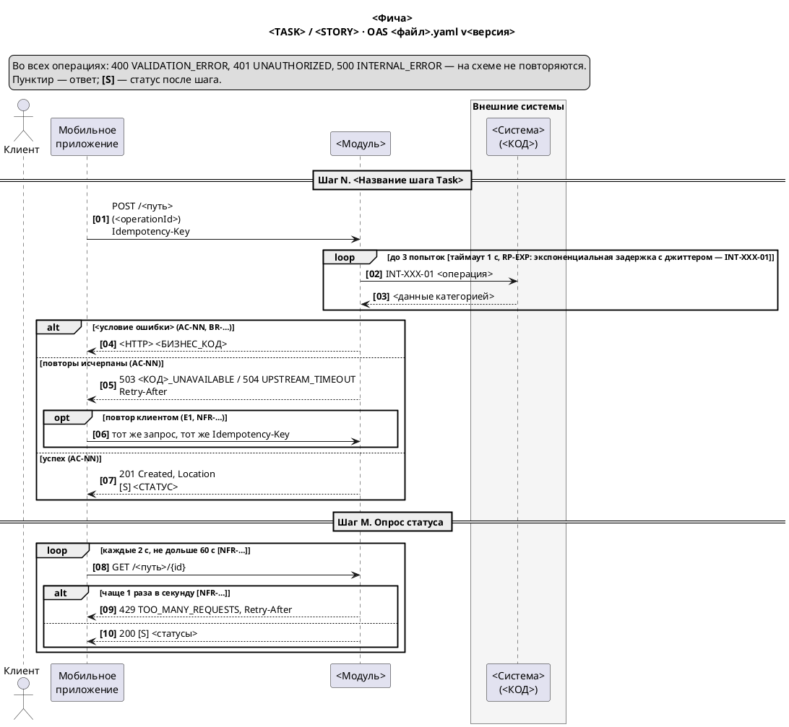

# oas-from-jira

Skill превращает требования из Jira в два согласованных артефакта и предлагает их через один Pull Request:

1. **OpenAPI Specification** клиентского API;
2. **sequence-диаграмму в PlantUML** с кодами ошибок и ретраями.

Оба артефакта строятся из **одних и тех же источников** и **одной таблицы трассировки** (шаг 5). Диаграмма не вводит новых операций, кодов и статусов: всё, что на ней есть, есть в OAS или в контракте интеграции. Результат — черновик для проверки человеком, а не финальный документ.

## Когда применять

- Пользователь даёт ключ (`SCRUM-2194`) или ссылку на задачу Jira и просит OAS / OpenAPI / контракт API.
- Задача описывает фичу, у которой есть клиентский API.

Если пользователь просит только диаграмму или только OAS, всё равно выполнить шаги 1–5 полностью (общая трассировка), затем — шаги нужного артефакта.

**Не применять:** для AsyncAPI, ER-диаграмм, диаграмм состояний и других артефактов; для API внутренних адаптеров к внешним системам (если задача прямо этого не просит).

## Предусловия

| Что нужно | Если нет |
|---|---|
| Atlassian MCP (чтение задач, комментарий) | Попросить пользователя вставить текст Task и Story; в отчёте указать, что требования получены не из Jira. |
| GitHub MCP с правом записи в репозиторий skill | Подготовить файлы и описание PR, отдать пользователю; в отчёте указать, что PR не создан. |
| Node.js для Spectral | Установить через `npm`; если невозможно — не выдавать результат как проверенный. |
| Java и `plantuml.jar` для проверки диаграммы | Скачать jar из Maven Central (`https://repo1.maven.org/maven2/net/sourceforge/plantuml/plantuml/<версия>/plantuml-<версия>.jar`); если невозможно — не выдавать диаграмму как проверенную и указать это в отчёте. |

## Вход

1. **Task** — ключ или ссылка из запроса пользователя.
2. **Story** — задача типа «История», связанная с Task связью **relates to**.
3. **Контекст продукта** — `knowledge/context/<продукт>/`: `functional-requirements.md`, `non-functional-requirements.md`, `integrations.md`. Пользователь может передать контекст текстом или файлами — тогда он заменяет папку.
4. **Общие знания** — `knowledge/`: `glossary.md`, `business-rules.md`, `sensitive-data.md`, `oas-conventions.md`.

**Приоритет источников при противоречии:** AC в Story → Task → контекст → knowledge. Каждое противоречие записывается в отчёт.

**Что из источников даёт диаграмма** (отдельного источника для диаграммы нет):

| Источник | Что берётся для диаграммы |
|---|---|
| Task: «Акторы», «Внешние системы» | Участники (`participant`) и их порядок |
| Task: «Основной сценарий» `[API]` / `[EXT:…]` | Сообщения и их последовательность; разделы `== Шаг N ==` |
| Task: альтернативы `A*`, исключения `E*` | Ветки `alt` / `else` с кодом ошибки или финальным статусом |
| Story: AC | Подписи веток (`AC-NN`) и ожидаемый результат |
| `integrations.md` | Операции `INT-*`, режим (синхронно / асинхронно), таймауты, политика повтора, соответствие ошибок внешних систем кодам модуля |
| `non-functional-requirements.md` | Интервал и предел опроса, лимиты частоты (`429`), повтор с `Idempotency-Key`, уточнение статуса при таймауте |
| `business-rules.md` §8, §9 | Статусы заявки и бизнес-коды ошибок |
| OAS из шага 6 | Методы, пути, `operationId`, HTTP-коды — диаграмма их только повторяет |

## Шаги

### 1. Прочитать Task
- Получить задачу через Atlassian MCP (описание, метки, связи).
- Определить продукт и найти `knowledge/context/<продукт>/`.
- Если описание не следует шаблону `templates/jira-task.md`, всё равно извлечь: цель, акторов, границы, предусловия, шаги сценария, альтернативы, внешние системы.

### 2. Найти Story
- Взять связи Task типа **relates to** с задачами типа «История».
- Одна Story — использовать её. Несколько — использовать все и указать это в отчёте. Ни одной — продолжить по Task, критерии приёмки вывести из сценариев и пометить как допущения.
- Пустая Story (нет AC) приравнивается к отсутствующей.

### 3. Проверить полноту входа
Сверить, что есть: AC в Story; в Task — границы, основной сценарий с разметкой `[UI]` / `[API]` / `[EXT:…]`, альтернативы; в контексте — три файла.
**При нехватке данных не останавливаться:** принять разумное допущение, записать его в отчёт, в `x-assumption` у соответствующего элемента OAS и в `note` на диаграмме с префиксом `Допущение A-NN`.

Для диаграммы дополнительно проверить, что в `integrations.md` у каждой внешней системы, участвующей в сценарии, заданы таймаут и политика повтора (раздел «Политика повтора» и раздел системы). Если не заданы — принять «без повтора» и записать как допущение (ретраи не додумываются).

### 4. Загрузить знания
Прочитать `knowledge/oas-conventions.md` полностью. Из `business-rules.md` — правила, на которые ссылаются задача и контекст, статусные модели и каталог кодов (§9). Из `sensitive-data.md` — каталог полей (§3) и правила API (§5). Глоссарий — по необходимости.

### 5. Построить трассировку до написания YAML и диаграммы
Составить одну таблицу для обоих артефактов (она войдёт в `-check.md`):

| Требование | Элемент OAS | Элемент диаграммы |
|---|---|---|
| Шаг `[API]` сценария | Операция (метод + путь) | Сообщение `App -> M` с методом, путём и `operationId` |
| Шаг `[EXT:…]` | `x-external-systems`, 503/504 | Сообщение `M -> <система>` с ID `INT-*` |
| Шаг без `[API]`, выполняемый сервером (обратный вызов, асинхронный результат) | Переход статуса в `enum` и в `description` получения ресурса | Сообщение `<система> -> M` (служебное) + `[S]` новый статус |
| AC (Дано / Когда / Тогда) | Операция + код ответа + поле / статус / бизнес-код | Ветка `alt` с подписью `AC-NN` |
| Альтернатива / исключение | Ответ 4xx/5xx с бизнес-кодом или переход статуса | Ветка `else` с тем же HTTP-кодом и бизнес-кодом или статусом |
| Бизнес-правило | Проверка → ответ, `x-business-rules` | Условие ветки с ID `BR-*` |
| НФТ с отражением в OAS | Ответ 429, асинхронность 202, заголовок, `description` | `loop` опроса, ветка 429, повтор с `Idempotency-Key` |
| Политика повтора и таймауты (`integrations.md`, НФТ) | — (только `description`) | Блок `loop` ретрая с лимитом и ID источника; ветка «повторы исчерпаны» с кодом |

Правила разбора:
- Шаги `[UI]` операций **не дают**. Служебные endpoint'ы (обратные вызовы внешних систем) не описываются, если Task исключает их из объёма.
- Переход статуса, который делает сервер без вызова клиента, отражается в `enum` статуса и в `description` операции получения ресурса.
- Шаг, ответ которого зависит от долгой внешней операции (по НФТ или контракту интеграции), — `202` + ресурс со статусом.
- `409` — недопустимое состояние (ресурс уже есть, шаг не в своём статусе); `422` — нарушение бизнес-правила; `403` — блокировка или идентификация клиента; `404` — нет или чужой ресурс.
- `503` / `504` — **только** у операций, которые вызывают внешнюю систему (по `integrations.md`).
- `429` — **только** у операций, для которых в НФТ задан лимит частоты.
- `Idempotency-Key` — у **каждого** `POST`, включая переходы статуса (принятие договора, отмена, подтверждение), а не только у создания ресурса и денежных операций. Причина: если сервер выполнил переход, а клиент получил таймаут (504), повтор без ключа вернёт `409 INVALID_APPLICATION_STATE`, и клиент не узнает, выполнен ли шаг (BR-IDM-01, OAS-HDR-03; проверяется правилом Spectral `post-idempotency-key`).
- Дополнительные поля ошибки (например, идентификатор существующей заявки) — только если их требует AC.
- Если AC требует сверки с **актуальными** данными внешней системы («Банк России опубликовал новую версию», текущий статус, остаток), а у шага Task нет `[EXT:…]`, — это противоречие AC и Task, а не повод обойтись без вызова. По приоритету AC → Task операция вызывает систему в том же запросе (ID `INT-*`, `503`/`504` по `integrations.md`), противоречие записывается в отчёт. Решение, при котором AC может не выполниться (кэш, данные прошлого шага), не допускается: например, версия договора, сохранённая на шаге 6, не покажет версию, опубликованную до шага 8 (ERR-02).
- Статус из `business-rules.md` §8 переносится **вместе с атрибутами**, которые модель для него требует (`rejectReason` у `REJECTED`, `errorCode` у `FAILED`), и с условиями перехода — в `description` и на диаграмме. Если условия перехода не заданы в источниках, статус остаётся в `enum` с `x-assumption` и открытым вопросом; оставить статус, но выбросить его атрибуты нельзя — клиент получит статус, который не сможет обработать (OAS-TYPE-08, ERR-03).

- Ретрай — **только** там, где его задаёт источник: политика повтора в `integrations.md`, «повтор с тем же ключом» в Task или НФТ, опрос статуса в НФТ. Где источник запрещает повтор (денежная операция без уточнения статуса, изменяющая операция в АБС), на диаграмме ставится `note` «без повтора» с причиной.
- Ответ внешней системы переводится в код модуля по таблице соответствия ошибок в `integrations.md`; на диаграмме подписываются оба: что вернула система и что получает клиент.

Каждый элемент будущей OAS и диаграммы должен иметь строку в таблице. Элемент без источника не добавляется.

### 6. Написать спецификацию
- Файл `artifacts/<продукт>-<область>-api.yaml` по `knowledge/oas-conventions.md`: начать со скелета (§15), затем операции, затем схемы.
- У операций: `operationId`, `summary`, `description` (предусловия, внешние вызовы, синхронность, коды 409/422), `tags`, `x-jira-key`, `x-acceptance-criteria`, `x-business-rules`, `x-external-systems`.
- Чувствительные поля — `x-sensitivity` и маскированные поля `*Masked` по `sensitive-data.md`.
- Примеры — только синтетические; у каждой операции минимум один успешный и один ошибочный пример.
- Удалить из `components` всё, на что нет ссылок.

### 7. Проверить Spectral
```bash
npx @stoplight/spectral-cli@6 lint artifacts/<имя>-api.yaml --ruleset .spectral.yaml
```
Ошибок быть не должно. Исправлять причину, а не правило: `.spectral.yaml` в PR с артефактом **не меняется**. Предупреждения — объяснить в отчёте.

### 8. Написать sequence-диаграмму
Файл `artifacts/<продукт>-<область>-sequence.puml` по разделу «Соглашения по sequence-диаграмме» ниже. Писать **после** того, как OAS прошла Spectral: методы, пути, `operationId`, HTTP- и бизнес-коды копируются из готовой OAS, а не формулируются заново.

Порядок работы:
1. Скелет: заголовок, участники, легенда.
2. Основной сценарий по шагам Task: для каждого шага — раздел `== Шаг N. … ==`.
3. Для каждого шага `[API]` — все ответы операции из OAS, кроме общих 400/401/500: успех и каждая ветка ошибки (`alt` / `else`).
4. Ретраи и таймауты из `integrations.md` — у каждого вызова внешней системы.
5. Асинхронные результаты и обратные вызовы — служебными сообщениями с переходами статуса.
6. Опрос статуса — `loop` с интервалом и пределом из НФТ.

### 9. Проверить диаграмму
```bash
java -jar plantuml.jar -checkonly artifacts/<имя>-sequence.puml   # синтаксис: код возврата 0
java -DPLANTUML_LIMIT_SIZE=16384 -jar plantuml.jar -tpng -o /tmp/puml artifacts/<имя>-sequence.puml   # рендер для просмотра
```
Без `-DPLANTUML_LIMIT_SIZE` PlantUML обрезает изображение на 4096 px, и низ длинной диаграммы при просмотре не виден. Открыть PNG целиком (при необходимости — частями) и проверить читаемость: подписи не обрезаны, ветки не пустые. PNG в репозиторий не коммитится.

Сверка бизнес-кодов OAS ↔ диаграмма (вывод должен быть пустым):
```bash
Y=artifacts/<имя>-api.yaml; P=artifacts/<имя>-sequence.puml
grep -oE '^\| `[A-Z_]+` \| [0-9]{3}' knowledge/business-rules.md | grep -oE '[A-Z_]{4,}' | sort -u |
while read c; do
  y=$(grep -c "\b$c\b" $Y); p=$(grep -c "\b$c\b" $P)
  [ $y -gt 0 ] && [ $p -eq 0 ] && echo "нет в диаграмме: $c"
  [ $y -eq 0 ] && [ $p -gt 0 ] && echo "нет в OAS: $c"
done
```
Так же вручную сверить: каждое значение статуса заявки из OAS встречается на диаграмме в метке `[S]`; каждая операция OAS есть на диаграмме.

### 10. Самопроверка
Пройти чек-лист ниже. Найденное исправить и повторить шаги 7 и 9.

### 11. Написать отчёт проверки
`artifacts/<имя>-check.md` по шаблону `templates/artifact-check.md`: источники, результат Spectral, результат проверки PlantUML и сверки кодов, матрица покрытия AC (для каждого AC — элемент OAS и элемент диаграммы), трассировка элементов, **таблица ретраев** (вызов → таймаут → число повторов → исход после исчерпания → источник), допущения, противоречия, открытые вопросы. Раздел «Проверка человеком» оставить пустым.

### 12. Создать Pull Request
Через GitHub MCP:
1. Ветка `oas/<ключ-task>-<краткое-имя>` от `main`.
2. **Один коммит** с YAML, `.puml` и `-check.md`: `draft(agent): <ключ-task> <фича> — OpenAPI и sequence-диаграмма`. Других изменений в коммите нет.
3. PR `<ключ-task>: <фича> — OpenAPI и sequence-диаграмма` с описанием: ключи Task и Story, файлы, результат Spectral, результат проверки PlantUML, ссылка на `-check.md`, открытые вопросы.
4. Не мержить.

### 13. Сообщить результат
- Комментарий в Task через Atlassian MCP: ссылка на PR и число открытых вопросов.
- Пользователю: ссылка на PR, итог Spectral и PlantUML, **полный код диаграммы одним блоком ```plantuml```, готовым для вставки в редактор PlantUML** (от `@startuml` до `@enduml`, без сокращений), допущения и открытые вопросы списком.

## Формат результата

| Файл | Содержание |
|---|---|
| `artifacts/<продукт>-<область>-api.yaml` | OpenAPI 3.0.3, проходит Spectral без ошибок |
| `artifacts/<продукт>-<область>-sequence.puml` | Sequence-диаграмма PlantUML: проходит `-checkonly`, коды совпадают с OAS |
| `artifacts/<продукт>-<область>-api-check.md` | Отчёт проверки по шаблону (общий для OAS и диаграммы) |
| Pull Request | Ветка `oas/…`, коммит `draft(agent): …` |
| Комментарий в Jira | Ссылка на PR |
| Ответ пользователю | Код диаграммы блоком ```plantuml```, готовый для вставки в редактор |

## Соглашения по sequence-диаграмме

**Файл и формат**
- Один самодостаточный файл: `@startuml <имя-файла>` … `@enduml`. Без `!include`, `!theme` по URL и внешних ссылок — код вставляется в любой редактор PlantUML и рисуется без доступа к сети.
- Тексты — на русском; идентификаторы (пути, `operationId`, коды, статусы, `INT-*`, `BR-*`, `AC-*`) — как в источниках.
- `title`: название фичи, ключи Task / Story, имя и версия OAS.
- `autonumber` — номера сообщений, на них можно ссылаться в отчёте и в ревью.

**Участники** — в порядке первого появления в сценарии:
- `actor` клиента; `participant` приложения; `participant` модуля;
- внешние системы — в `box "Внешние системы"`, алиас — короткий, в подписи — название и код из `integrations.md` (`АБС\n(CORE_BANKING)`);
- участник, который в сценарии не вызывается, на диаграмму не добавляется.

**Сообщения**
- Запрос клиента: `App -> M : <МЕТОД> <путь>\n(<operationId>)` + значимые заголовки (`Idempotency-Key`).
- Ответ модуля: пунктир `-->`, `<HTTP-код> <бизнес-код>`; при успехе — код и `[S] <статус>` после шага.
- Вызов внешней системы: `M -> ABS : INT-ABS-01 <название операции>`. Данные — только категориями («профиль клиента»), без значений ПДн, токенов, кодов авторизации.
- Асинхронный результат или обратный вызов: `DRP -> M` / `ESIA -> M` с пометкой «служебный, вне клиентского API», затем `[S]` новый статус.
- Антифрод: только решение (`ALLOW` / `REVIEW` / `DENY`) и статус заявки; правила и признаки проверки не показываются (BR-AF-03).

**Ошибки**
- Каждая альтернатива и исключение — ветка `alt` / `else` с условием `[причина (AC-NN, BR-…)]` и ответом `<HTTP-код> <бизнес-код>`, ровно как в OAS. Для отказов без HTTP-ошибки — `[S] REJECTED (<rejectReason>)`.
- Ошибка внешней системы подписывается дважды: что вернула система → в какой код модуля переведена (по таблице соответствия `integrations.md`).
- Общие ответы 400 / 401 / 500 не рисуются в каждой операции — одной строкой в `legend`.

**Ретраи и таймауты** — только из источников (`integrations.md`, НФТ, Task):

| Случай | Конструкция PlantUML | Что подписать |
|---|---|---|
| Повтор вызова внешней системы модулем | `loop до N попыток [таймаут X с, INT-…]` вокруг вызова, затем `alt` «повторы исчерпаны» → `503`/`504` | Таймаут, число повторов, ID операции и источника |
| Повтор запрещён | `note right of M : без повтора — <причина>` | Источник запрета (например, NFR-AV-03) |
| Повторы исчерпаны | `alt повторы исчерпаны` → действие по правилу системы (например, антифрод: `503 SERVICE_UNAVAILABLE`, объект не меняется) | Правило из раздела системы в `integrations.md` |
| Повтор клиентом после 503/504 | `opt повтор клиентом` → тот же запрос, **тот же** `Idempotency-Key`; ответ 5xx по ключу не сохранялся, поэтому запрос выполняется заново, **проверки (включая антифрод) повторяются** | Источник (E-сценарий Task, NFR-AV-04, BR-IDM-03) |
| Повтор клиентом после таймаута, когда сервер уже выполнил шаг | `opt повтор клиентом` → тот же `Idempotency-Key`; ответ — сохранённый итоговый результат (2xx / 4xx), а не `409` | BR-IDM-01, NFR-AV-04 |
| Опрос асинхронного результата | `loop каждые X с, не дольше Y с [NFR-…]` + ветка `429` при превышении частоты; после Y с — `note` о поведении приложения | Интервал, предел, лимит частоты |
| Неопределённый асинхронный результат | `alt нет ответа за X с` → `INT-…` уточнение статуса | Источник (NFR-AV-03 или аналог) |

**Шаблон** (структура, не содержание; проверен PlantUML 1.2024):



## Чек-лист перед созданием PR

**Покрытие**
- [ ] Каждый AC из Story есть в матрице покрытия и закрыт операцией, ответом или статусом (или помечен «вне OAS» с причиной).
- [ ] Каждый шаг `[API]` из Task дал операцию.
- [ ] Каждая альтернатива и исключение из Task дали ответ или переход статуса.
- [ ] Ни одно допущение не делает AC невыполнимым (кэш или данные прошлого шага вместо запроса к системе, когда AC требует актуальности).

**Ничего лишнего**
- [ ] У каждой операции, схемы, поля и ответа есть строка в трассировке.
- [ ] Нет операций для шагов `[UI]` и для того, что Task относит к «Не входит».
- [ ] `503`/`504` только там, где есть внешний вызов; `429` только там, где есть лимит в НФТ.
- [ ] В `components` нет неиспользуемого.

**Соглашения и данные**
- [ ] Spectral — 0 ошибок.
- [ ] У каждого `POST` (включая переходы статуса) есть обязательный `Idempotency-Key`.
- [ ] Бизнес-коды ошибок — из каталога `business-rules.md` §9; новые коды перечислены в отчёте.
- [ ] Статусы совпадают со статусной моделью `business-rules.md` §8 или расхождение объяснено.
- [ ] У каждого статуса в `enum` есть атрибуты из §8 (`rejectReason`, `errorCode`) и условия перехода — или открытый вопрос с `x-assumption`.
- [ ] C2/C3-данных нет в путях и query; секреты `writeOnly`; ответы с C2/C3 содержат `Cache-Control: no-store`.
- [ ] Примеры синтетические; в файлах нет токенов, реальных ПДн и данных под NDA.

**Sequence-диаграмма**
- [ ] `plantuml -checkonly` — код возврата 0; PNG просмотрен, подписи читаются.
- [ ] Сверка бизнес-кодов OAS ↔ диаграмма — пустой вывод.
- [ ] Каждая операция OAS — сообщение `App -> M` с тем же методом, путём и `operationId`.
- [ ] Каждый ответ операции из OAS (кроме 400/401/500) — ветка с тем же HTTP- и бизнес-кодом; каждая альтернатива и исключение Task — ветка.
- [ ] Каждый статус заявки из OAS встречается в метке `[S]`; каждый `rejectReason` — в ветке `REJECTED`.
- [ ] У каждого вызова внешней системы показаны таймаут и повтор (или «без повтора») со ссылкой на источник; ретраев без источника нет.
- [ ] Повтор клиентом после 503/504 — с тем же `Idempotency-Key`; на диаграмме видно, что проверки выполняются заново (5xx по ключу не сохраняется).
- [ ] Нет значений ПДн, токенов, деталей антифрода и ПОД/ФТ; нет `!include` и внешних ссылок.

**Отчёт**
- [ ] Все допущения записаны в отчёт, в `x-assumption` и в `note` на диаграмме.
- [ ] Противоречия между источниками перечислены с принятым решением.

## Запреты

- Не добавлять элементы, которых нет в требованиях, «для полноты» или «по best practice».
- Не додумывать ответы на открытые вопросы — записывать их в отчёт.
- Не менять `knowledge/`, `SKILL.md`, `.spectral.yaml` в PR с артефактом.
- Не ослаблять правила Spectral, чтобы пройти проверку.
- Не добавлять на диаграмму операции, коды, статусы и ретраи, которых нет в OAS или в источниках; не «улучшать» на диаграмме то, что не сделано в OAS, — сначала исправить OAS.
- Не выдавать пользователю диаграмму фрагментом или с сокращениями («…») — только полный код от `@startuml` до `@enduml`.
- Не коммитить в `main` и не мержить PR.
- Не публиковать токены, реальные ПДн, данные под NDA, выгрузки задач Jira.
- Не раскрывать в API детали антифрода и мер ПОД/ФТ.